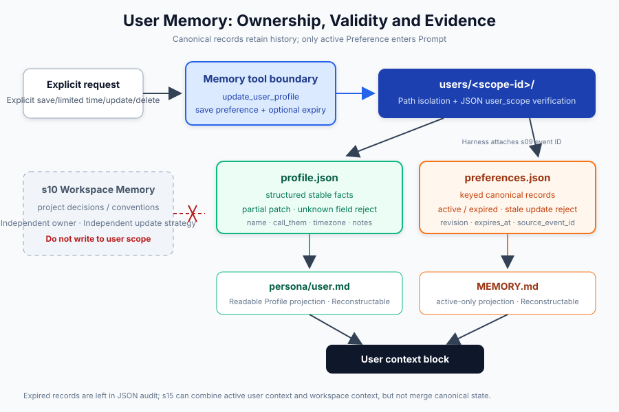
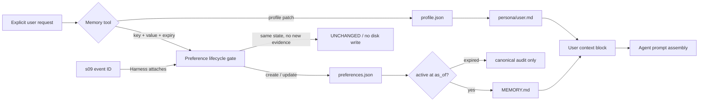

# s11: User Memory - Profile and Preferences Need User Scope

[中文](README.md) · [English](README.en.md)
> *Cross-project preferences belong to the user scope, with explicit updates and soft deletion.*
>
> **Harness layer: user profile projection and preference boundaries.**

---



## What This Lesson Adds

s10 can already distill project decisions, conventions, and lessons learned into workspace memory, but the following information belongs to no project:

- how the user wants to be addressed;
- the user's time zone;
- reply in Chinese in every project;
- prefer concise explanations by default;
- always use tabs in the editor.

Writing these into every project causes duplication, drift, and cross-user contamination. Appending every description that appears in conversation directly to one `MEMORY.md` means that once a preference is updated, the old and new versions coexist.

This chapter designs user memory as two distinct contracts:

| Type | Question answered | Update method | Example |
|---|---|---|---|
| Profile | "Who is this user?" | Explicit field patch | `name`, `call_them`, `timezone` |
| Preference | "What is the cross-project default?" | Create, replace, or delete by stable key | `response.language=Chinese` |

Both belong to the user scope, but they cannot be mixed into arbitrary Markdown: Profile needs field-level updates, and Preference needs conflict replacement and idempotent retries.

## Design Goals

The core of this chapter is not "store one more file" but letting the harness answer seven questions:

1. **Who is the owner?** Every piece of state carries a stable `user_scope`, so one root directory can safely hold multiple users.
2. **Is the write explicit?** Only explicit tools such as `update_user_profile` and `save_user_preference` can change state.
3. **What happens on a repeated call?** Only when value, source, expiry, and source event are all identical is it a no-op: the file does not grow and the revision does not increase.
4. **What happens when a preference changes?** A new state for the same key replaces the old one, and an older timestamp cannot roll back newer canonical evidence.
5. **When does a temporary preference stop applying?** Once `expires_at` is reached the record remains auditable, but it no longer enters `MEMORY.md` or the prompt.
6. **Where did the preference come from?** The harness can store the s09 transcript event ID; this field is not open for the model to invent.
7. **What is trusted after a process restart?** JSON is the canonical state; Markdown is only the active, prompt-facing projection and can be repaired from JSON.

## Code Architecture Diagram



There is an important boundary here: `UserMemory` takes no workspace path and does not read s10 logs. User context and workspace context can be merged when s15 assembles the prompt, but storage, update policy, and ownership stay separate.

## Storage Model

The teaching implementation writes to `~/.learn_workbuddy/user-memory/` by default and never touches real product directories:

```text
~/.learn_workbuddy/user-memory/
└── users/
    └── <scope-id>/
        ├── profile.json
        ├── preferences.json
        ├── MEMORY.md
        └── persona/
            ├── core.md
            ├── identity.md
            ├── user.md
            └── bootstrap.md
```

`scope-id` is a stable digest of the normalized user identifier. It serves two purposes:

- an arbitrary account identifier never becomes a path directly, so `/`, spaces, or email addresses do not appear in the directory structure;
- the canonical JSON also stores the same `user_scope`, so even if a file is mistakenly copied into another user's directory, it is rejected on read instead of silently injected into the wrong user's prompt.

### Canonical State and Projection

| File | Role | Source of truth? |
|---|---|---|
| `profile.json` | Structured user profile | Yes |
| `preferences.json` | Complete keyed preference set with revision, expiry, and source event; includes deletion tombstones, never deleted content | Yes, including expired records |
| `persona/user.md` | Human-readable profile projection | No; rebuildable |
| `MEMORY.md` | Preference projection for inspection and prompt injection | No; rebuildable |
| `persona/core.md` | Assistant values and boundaries | Independent assistant identity |
| `persona/identity.md` | Assistant name, type, and emoji | Independent assistant identity |
| `persona/bootstrap.md` | One-time onboarding instructions | Deleted after completion |

This design keeps Markdown from serving as database, editing protocol, and prompt all at once. People can inspect the Markdown, while code performs deterministic updates on JSON; when a projection is damaged, it is restored from the canonical state.

## Main Code Paths

### Profile: Explicit Partial Updates

```python
result = memory.update_profile({
    "name": "Alex",
    "call_them": "Alex",
    "timezone": "UTC+8",
})
```

Update rules:

- only fields present in the request are modified; absent fields stay unchanged;
- `None` means explicitly deleting a field;
- fields not in the schema raise an error, so the model cannot invent new fields every turn;
- identical values count as `unchanged` and the canonical JSON is not rewritten; if the Markdown projection is stale, the projection is still repaired;
- when a change happens, `profile.json` is atomically replaced, then `persona/user.md` is refreshed.

Field values must be strings that are non-empty after whitespace normalization and no longer than 1,000 characters; dicts, lists, numbers, and booleans are never implicitly converted to text. `None` means deletion only in an update request; it is not a storable field value. If any field in a partial update is invalid, the whole request fails and none of the previously validated fields are written.

Reading an existing `profile.json` also checks field names, types, and text constraints; for example, `{"name": null}` on disk raises `UserMemoryValidationError` instead of becoming `Name: None` injected into the prompt. Validation completes before the Markdown projection is generated, and on failure neither the original JSON nor the projection is overwritten; normal reads do not rewrite JSON, and valid v1/v2 records remain readable. Data whose original type was already converted to a string by an older version cannot be detected automatically this way; it must be handled after checking the original facts.

Profile is not a "persona" automatically extracted from chat content. Only information the user explicitly provides or explicitly asks to save enters this layer.

### Preferences: Keyed Deduplication

```python
created = memory.set_preference("response.language", "Chinese")
unchanged = memory.set_preference("response.language", "Chinese")
updated = memory.set_preference("response.language", "English")
```

The three calls return:

```text
CREATED   revision=1  previous=None     current=Chinese
UNCHANGED revision=1  previous=Chinese  current=Chinese
UPDATED   revision=2  previous=Chinese  current=English
```

Deduplication cannot just compare whole text. For example, "reply in Chinese" and "reply in English from now on" are not two coexisting long-term facts but two versions of the same `response.language` preference. The stable key provides the conflict domain, and the value represents the current state.

The full idempotency identity also includes `source`, `expires_at`, and `source_event_id`. The same value with an extended expiry or new source evidence is an observable update and increases the revision. A retry with the same non-empty event ID and the same full state is still `UNCHANGED`; even if the retry passes a later time, it does not advance the evidence time.

Without an event ID, an explicitly passed time later than the canonical `updated_at` means a new confirmation: even if the value is unchanged, `updated_at` is updated and the revision increases. A replay without an ID should keep the original evidence time; the same state with the same or an earlier time still writes nothing. The shorthand call that passes neither time nor event ID falls back to state deduplication, because a current time obtained automatically by the program cannot prove that the user confirmed again. Callers that need to record confirmation order should provide a stable event ID or an explicit evidence time, and must not pass off the retry arrival time as the evidence time.

For example, "Chinese" is written at 09:00 and the user confirms "Chinese" again at 11:00; a new confirmation without an event ID but explicitly carrying 11:00 advances the record to 11:00, and a delayed 10:00 "English" arriving afterward is rejected. A write with a different state must be later than the canonical `updated_at`, so replaying an old transcript cannot roll back a newer preference. This protects the time boundary of single sequential writes; it provides no cross-process concurrent write control or full event-history deduplication.

### Temporal Preference Projection

```python
memory.set_preference(
    "response.detail",
    "verbose during onboarding",
    source="transcript",
    source_event_id="session-7:event-42",
    updated_at="2026-08-01T01:00:00Z",
    expires_at="2026-08-02T01:00:00Z",
)
```

Timestamps must include a time zone and are stored uniformly as UTC. A preference is active when `as_of < expires_at`; it is expired the instant `expires_at` is reached. `list_preferences()` returns all canonical records; only `list_active_preferences(as_of=...)` returns the injectable set.

Expiry is not deletion: the record stays in `preferences.json` so it can explain why it once applied; `MEMORY.md` and `get_context_for_agent()` project only active records. An explicit historical `as_of` query is a pure read and never writes the historical view back to the current `MEMORY.md`.

`source_event_id` is harness provenance, not model-generated content. Programmatic callers can attach a stable s09 event ID to a write; the `save_user_preference` model tool accepts only a value and an optional expiry, and cannot submit or forge an event ID.

### Soft Deletion

```python
memory.delete_preference("response.language")
```

Deletion leaves a tombstone instead of popping the record. Without it, replaying the same evidence (same `source_event_id` and `updated_at`) would bring the forgotten preference back:

```text
CREATED  set_preference(..., updated_at="2026-10-01T00:00:00Z", source_event_id="session-1:e1")
DELETED  delete_preference("response.language")  -> deleted: [{key, deleted_at, revision, source}]
STALE    replay of the same evidence              -> StalePreferenceUpdateError, no resurrection
```

- The tombstone records only which key was deleted, never the deleted content: the old value is absent from `preferences.json`, `MEMORY.md`, and `get_context_for_agent()`. The user's original words in the s09 transcript are out of scope.
- Evidence newer than `deleted_at` recreates the preference with the next revision and clears the tombstone; older or equal evidence raises `StalePreferenceUpdateError`.
- Repeated deletion returns `UNCHANGED` and keeps the first `deleted_at`. An explicit `deleted_at` not later than the live `updated_at` raises and writes nothing.
- Every write path, including `append_memory()`, writes tombstones back. `list_preferences()` and `MEMORY.md` are unchanged; `list_deleted_preferences()` is a read-only audit view.
- The model forgets through `forget_user_preference`, whose schema has only the required `key`; the harness sets `source="model_tool"` and the time.

Expiry keeps the old value as audit evidence; forgetting removes it, so tombstones live in a separate `deleted` array.

#### Forgetting Boundaries

- Forgetting is not a permanent ban: newer evidence can restore the preference. Only timestamps decide, so a replay without `updated_at` (including `append_memory()` replaying the same old text) is written at the current time and recreates it. Replays must keep the original evidence time.
- A real harness should show the key to the user for confirmation before deleting.
- This chapter does not defend against prompt injection: text in `bash` output or workspace files may lure the model into forgetting. The "only when the user explicitly asks" wording is a convention, not a defense.
- Common assistant memory features also let users ask to forget a memory; this chapter borrows only that concept.

### User Scope

```python
alice = UserMemory(root, user_id="alice")
bob = UserMemory(root, user_id="bob")

alice.set_preference("editor.indent", "tabs")
bob.set_preference("editor.indent", "spaces")
```

The two share the state root directory but land in different `scope-id` directories. Reads also validate the `user_scope` inside the JSON: path isolation handles normal routing, and the scope marker catches a mistaken copy or a caller passing the wrong user.

### Prompt Context

```text
## Assistant values
...

## Assistant identity
...

## User profile
Name: Alex
Timezone: UTC+8

## Explicit user preferences (cross-project)
- `response.language`: Chinese
```

This block contains only user-owned context. Project decisions are never written here; s15 can load user context and workspace context separately for the current session, then decide order, budget, and override policy.

## Why Not Remember Every Sentence

Long-term memory enters future prompts. Automatically promoting chat content into user facts causes three problems:

- **Misattribution**: the user quoting someone else's view does not make it the user's preference;
- **Unclear lifetime**: a one-time request may be wrongly upgraded into a permanent rule;
- **Unexplainable**: the caller cannot explain why a memory was created, and it is hard to offer a way to undo it.

So this chapter takes a conservative approach: the model may suggest calling a memory tool, but the system prompt requires writes only when the user explicitly expresses long-term intent. A real production harness can also add ASK permissions, auditing, and visual confirmation before the tool runs.

## Boundaries with s10 and s12

| Layer | Owner | Content | Typical read time |
|---|---|---|---|
| s10 Workspace Memory | Workspace | Project decisions, conventions, pitfalls | When entering the project |
| s11 User Memory | User | Stable profile and explicit cross-project preferences | At session startup |
| s12 Remote Recall | Remote account/service | Long-term history candidates and remote profile | When the query needs it |

They can appear together in the final prompt, but they cannot share one unscoped `MEMORY.md`. The storage layer first guarantees correct ownership; retrieval and prompt assembly then decide what to use in this turn.

## Atomic Writes and Restart Recovery

Both Profile and Preference go through:

```text
validate -> serialize -> write temp file -> fsync -> os.replace
```

If the process fails while writing the temporary file, the old canonical file still exists; after a successful replace, no "half-written JSON" is left behind. A new process recovers the state simply by recreating `UserMemory(root, user_id=...)`, with no reliance on an in-memory cache.

The temporary file path is recorded immediately after the file is created; when `write`, `flush`, `fsync`, or `os.replace` raises, `finally` tries to delete the temporary file and reports the failure to the caller. Regression tests cover each of these four phases separately, checking that the old file is unchanged (or, for a first write, that the target still does not exist), that the temporary file is removed, and that a retry succeeds once the fault is cleared. Atomic replacement protects the target file, while exception cleanup avoids leaving temporary copies that contain user data; the two are not the same thing. Cleanup is not guaranteed if the process is forcibly killed, power is lost, or the delete itself fails, and no multi-file transaction is provided.

When `MEMORY.md` has been corrupted by hand, has gone stale, or is from an older version, `read_memory()` regenerates the active projection from the canonical records and the current time. This reflects a common harness principle: readable views can be repaired, while canonical state must have a clear boundary.

Profile likewise treats `profile.json` as authoritative. `load_identity()` does not just check whether `persona/user.md` exists; it compares its content with the expected text generated from the current Profile, atomically replaces the projection when they differ, and writes nothing when they already match. A no-change retry of `update_profile()` performs the same check, so if the JSON was saved but the Markdown write failed, either a retry or identity loading after a restart restores the view without changing any business field again. After the Profile is cleared or a field is deleted, the corresponding values in the old Markdown no longer enter the identity loading result.

For example, if the city changes from Shanghai to Beijing and only the JSON write completes, identity loading first repairs the old Markdown and then assembles the new Beijing context. If the repair write still fails, the exception propagates instead of treating the old data as a successfully loaded prompt. The two files are not one transaction: a projection failure after the JSON succeeds may still make the original write raise; recovery treats the JSON as authoritative and does not roll back the fact record. `read_profile()` itself stays a pure read, and `as_of` affects only the Preference time projection; it is not a historical query for Profile.

The current schema is v2, and the reader still accepts v1 profile and preferences. The `expires_at` and `source_event_id` missing from a v1 Preference are restored as `None` and saved uniformly as v2 on the next observable write; reading itself never modifies the canonical state for migration.

## Offline Verification

This chapter's tests cover:

- Profile partial update, deletion, and reading across restarts;
- Preference create/update/unchanged revision semantics;
- expiry time zone validation, the expiry boundary, and active/expired projection;
- source event provenance, recovery across restarts, and the boundary that the model cannot forge it;
- stale timestamp rollback protection and lifecycle/provenance revisions;
- schema v1 compatible reads and migration on the next observable update;
- only the current value is kept for the same key;
- two users sharing a root remain isolated;
- cross-scope JSON copied by mistake is rejected;
- prompt context contains no workspace state;
- `MEMORY.md` can be repaired from canonical preferences;
- deletion tombstones prevent resurrection, no original value remains after forgetting, and the `forget_user_preference` tool.

Run:

```bash
python3 -m pytest -q tests/test_user_memory.py tests/test_s11_preference_forget.py
python3 scripts/verify.py
```

## Teaching Demo

View the contracts this chapter adds to the learning path, offline:

```bash
python s11_user_memory/code.py --demo
```

Run the interactive model example:

```bash
MODEL_ID=<model> ANTHROPIC_API_KEY=<key> python s11_user_memory/code.py
```

Switch the local teaching user and state root directory through environment variables:

```bash
WORKBUDDY_USER_ID=alice \
WORKBUDDY_HOME=/tmp/learn-workbuddy \
python s11_user_memory/code.py
```

## Exercises

1. Extend the single `source_event_id` into a bounded evidence set, while keeping retries of the same evidence idempotent.
2. Add an explicit renewal-confirmation flow for preferences that are about to expire, and compare the permission boundaries of "automatic renewal" and "user confirmation".
3. Using the explicit priorities in s15 as a reference, design a trusted adapter that projects a User Default into a candidate, and show that the model cannot declare `current_turn` or `workspace_override` on its own.

## Next Lesson

s11 has defined "what the stored user state is". s12 goes on to separate stored memory from recalled context: long-term remote history is not injected into the prompt in full, but returned as a candidate view with source and score for the current query.

The original Chinese README remains the primary-language reference. This English companion keeps the same code, diagrams, local paths, and chapter structure so readers can switch languages without losing runnable details.

Local references:

- [Reference](README.md)
- [Reference](README.en.md)
- [Reference](./images/user-memory-en.svg)
